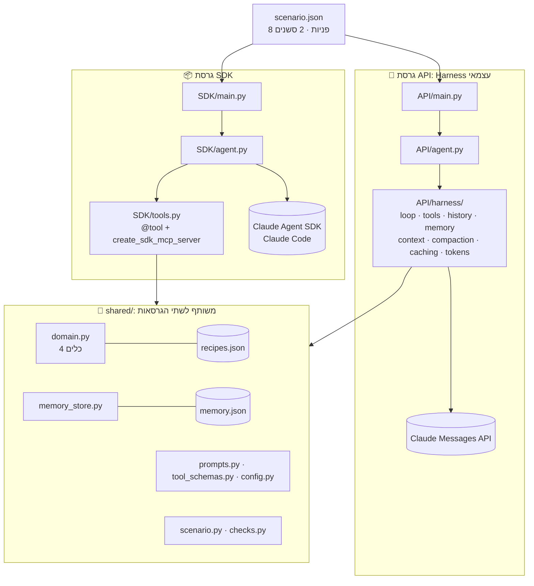

<div align="center">

# 🥗 MealPlannerAgent

**סוכן AI לתכנון ארוחות ולהפקת רשימות קניות. נבנה פעמיים: עם Harness עצמאי מעל Claude API, ועם Claude Agent SDK.**


[📄 הדוח המלא](REPORT.md) · [🧪 התרחיש](scenario.json) · [📊 טבלת ההשוואה](results/comparison.md)

</div>

---

## 🎯 על הפרויקט

אותו סוכן נבנה פעמיים, מעל אותו קוד דומיין, כדי להשוות בין שתי דרכים לבנות סוכן:

- **🔧 גרסת API:** אנחנו כותבים בעצמנו את כל ה-harness: לולאת הכלים, היסטוריה, זיכרון, בחירת context, ‏compaction, ‏caching ומדידת טוקנים.
- **📦 גרסת SDK:** ‏Claude Agent SDK מריץ את הלולאה ואת ניהול השיחה, ואנחנו מספקים רק כלים, prompt, זיכרון ומגבלות.

הכלים, המתכונים, ה-prompt, התרחיש והבדיקות משותפים לשתי הגרסאות. גם המודל וה-effort זהים: `claude-opus-5-5`, ‏`effort="medium"`.

## ✨ יכולות הסוכן

| | כלי | מה הוא עושה |
|---|---|---|
| 🔍 | `search_recipes` | חיפוש ב-[`recipes.json`](shared/recipes.json) (17 מתכונים) לפי שם, רכיב, ארוחה, דיאטה, הימנעויות וזמן הכנה |
| 💾 | `save_preference` | שמירת דיאטה, מאכלים להימנע מהם ומגבלת זמן בזיכרון בדיסק. ערך חדש מחליף את הישן |
| 📅 | `plan_meals` | תוכנית ל-1–7 ימים לפי ההעדפות השמורות, עם רכיבי המתכונים שנבחרו |
| 🛒 | `create_shopping_list` | רשימת קניות מאוחדת, עם סכום הכמויות לכל רכיב, מהתוכנית השמורה |

הזיכרון נשמר בדיסק בין סשנים: סשן חדש, על מופע חדש של הסוכן, זוכר את ההעדפות ואת התוכנית.

## 🏗️ ארכיטקטורה



**איך ה-SDK מחליף את קובצי ה-harness:**

| קובץ ב-harness של API | מה עושה את העבודה הזאת ב-SDK |
|---|---|
| `loop.py` | לולאת ה-SDK (`client.query()` ו-`receive_response()`, ועוד `max_turns`) |
| `tools.py` | `@tool` ו-`create_sdk_mcp_server` |
| `history.py` | שמירה מובנית, והמשך סשן עם `resume=session_id` |
| `memory.py` | אותו `MemoryStore`, ועוד [`CLAUDE.md`](SDK/agent_home/CLAUDE.md) כזיכרון פרויקט |
| `context.py` | hook מסוג `UserPromptSubmit` עם `additionalContext` |
| `compaction.py` / `caching.py` | אוטומטיים ב-SDK |
| `tokens.py` | `ResultMessage.usage` ו-`total_cost_usd` |

## 📁 מבנה הפרויקט

```text
MealPlannerAgent/
├── API/
│   ├── main.py              # צ'אט / הרצת תרחיש (Messages API)
│   ├── agent.py             # מחבר את רכיבי ה-harness
│   └── harness/             # 8 קבצים: loop, tools, history, memory,
│                            #           context, compaction, caching, tokens
├── SDK/
│   ├── main.py              # צ'אט בעברית / הרצת תרחיש (Agent SDK)
│   ├── agent.py             # ClaudeSDKClient, hook זיכרון, מדידה
│   ├── tools.py             # @tool + create_sdk_mcp_server
│   └── agent_home/CLAUDE.md # זיכרון הפרויקט של הסוכן
├── shared/                  # כלים, מתכונים, זיכרון, prompt, תרחיש ובדיקות
├── tests/                   # 92 בדיקות offline (FakeClient / FakeSDKClient)
├── results/
│   ├── sdk.json             # הרצת SDK אמיתית
│   ├── sdk_before_fixes.json# הרצת SDK ראשונה, לפני התיקונים
│   ├── api_simulated.json   # סימולציה של ה-API (FakeClient)
│   └── comparison.md        # טבלת ההשוואה
├── scenario.json            # 8 פניות בשני סשנים
├── compare.py               # השוואה וספירת שורות קוד
├── simulate_api.py          # הרצה מדומה של גרסת ה-API
├── REPORT.md                # הדוח המלא
├── pyproject.toml · uv.lock # גרסאות נעולות
└── .env.example             # דוגמה בלבד, בלי מפתח
```

## 🚀 התקנה והרצה

**דרישות:** Python 3.13 ו-uv.

```powershell
git clone <repo-url>
cd MealPlannerAgent
uv sync                      # מתקין בדיוק את הגרסאות שב-uv.lock
```

### 📦 גרסת SDK

ה-SDK משתמש בהתחברות של Claude Code (`claude auth login`) או ב-`ANTHROPIC_API_KEY`. `SDK/main.py` עוצר אם מוגדר משתנה סביבה שיחייב חשבון API, אלא אם מוסיפים `--allow-api-key`.

```powershell
uv run python SDK/main.py                         # צ'אט חדש בעברית
uv run python SDK/main.py --last                  # המשך הסשן האחרון
uv run python SDK/main.py --resume <session_id>   # המשך סשן מסוים
uv run python SDK/main.py --scenario scenario.json --out results/sdk.json --stderr-log
```

### 🔧 גרסת API

צריך מפתח API מ-Claude Console. מעתיקים את `.env.example` ל-`.env` ושמים בו את המפתח. הקובץ `.env` לא נכנס ל-Git.

```powershell
uv run python API/main.py --session s1            # צ'אט
uv run python API/main.py --scenario scenario.json --out results/api.json
```

### 🧪 סימולציה, השוואה ובדיקות

```powershell
uv run python simulate_api.py                     # API עם FakeClient -> results/api_simulated.json
uv run python compare.py --out results/comparison.md
uv run python -m pytest -q                        # 92 בדיקות offline, בלי מפתח ובלי רשת
```

> ⚠️ הרצת תרחיש כותבת מחדש את קובץ התוצאות שלה ב-`results/`.

אפשר גם להפעיל את הסביבה (`.venv\Scripts\Activate.ps1`) ולהריץ ישירות `python API/main.py` ו-`python SDK/main.py`.

## 🧪 התרחיש: 8 פניות בשני סשנים

| # | סשן | הפנייה | מה נבדק |
|---|---|---|---|
| 1 | 1️⃣ | אילו מתכוני ערב יש במאגר? | כלי שניגש לקובץ חיצוני |
| 2 | 1️⃣ | אני לא אוכלת פטריות | שמירה בזיכרון |
| 3 | 1️⃣ | תוכנית ערב לשלושה ימים | שימוש בהעדפה |
| 4 | 1️⃣ | רשימת קניות לתוכנית | רשימה מהתוכנית השמורה |
| 5 | 2️⃣ מופע חדש | מה שמור עליי? | שליפה מהזיכרון |
| 6 | 2️⃣ | עכשיו אני כן אוכלת פטריות | סתירה של העדפה קיימת |
| 7 | 2️⃣ | תוכנית חדשה לשלושה ימים | ההעדפה החדשה משפיעה |
| 8 | 2️⃣ | מה ההעדפות שלי עכשיו? | ההעדפה החדשה נשמרה |

**9 בדיקות pass/fail:** שמונה מהן בודקות את **המצב השמור בדיסק** ואת הכלים שנקראו, ורק אחת בודקת טקסט של תשובה. הן נמצאות ב-[`shared/checks.py`](shared/checks.py).

| בדיקה | SDK (הרצה אמיתית) | API (סימולציה) |
|---|:---:|:---:|
| `clean_start` | ✅ | ✅ |
| `search_tool_used` | ✅ | ✅ |
| `mushroom_preference_saved` | ✅ | ✅ |
| `plan_3_days_without_mushrooms` | ✅ | ✅ |
| `shopping_list_created` | ✅ | ✅ |
| `new_instance_in_session2` | ✅ | ✅ |
| `memory_recalled_in_session2` | ✅ | ✅ |
| `contradiction_replaced_old_preference` | ✅ | ✅ |
| `mushroom_recipes_available_again` | ✅ | ✅ |
| **סה"כ** | **9/9** | **9/9 (simulated)** |

## 📊 השוואה בין API ל-SDK

הטבלה מציגה רק נתונים מאומתים. כל המספרים בה לקוחים מ-[`results/comparison.md`](results/comparison.md).

| מדד | 🔧 API | 📦 SDK |
|---|---|---|
| הרצה מול מודל אמיתי | ❌ לא בוצעה, רק סימולציה | ✅ בוצעה |
| בדיקות התרחיש | 9/9 *(simulated)* | **9/9** |
| קריאות למודל | 14 *(simulated)* | 15 |
| קריאות לכלים | 6 *(simulated)* | 7 |
| Input tokens (לא מה-cache) | — לא נמדד | 30 |
| Cache read / write | — לא נמדד | 48,618 / 7,912 |
| Output tokens | — לא נמדד | 2,456 |
| Cache read מכלל הקלט | — לא נמדד | 86.0% |
| זמן כולל | — לא נמדד | 38.68 ש' |
| עלות | — לא נמדדה | $0.1226 *(הערכה של ה-SDK)* |
| שורות קוד בחלקים המקבילים ל-harness | **297** | **107** |
| שורות קוד בסך הכול (בלי `shared/`) | 411 | 268 |

ההשוואה המלאה, הממצאים, היתרונות, החסרונות וההמלצה נמצאים ב-[REPORT.md](REPORT.md).

## 👩‍💻 מגישות

מלכי דיסלדורף ושירה שניידמן
